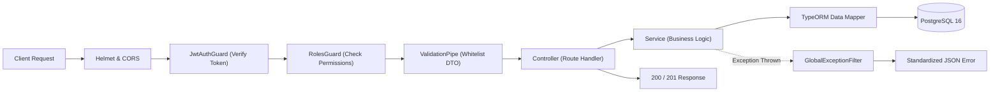
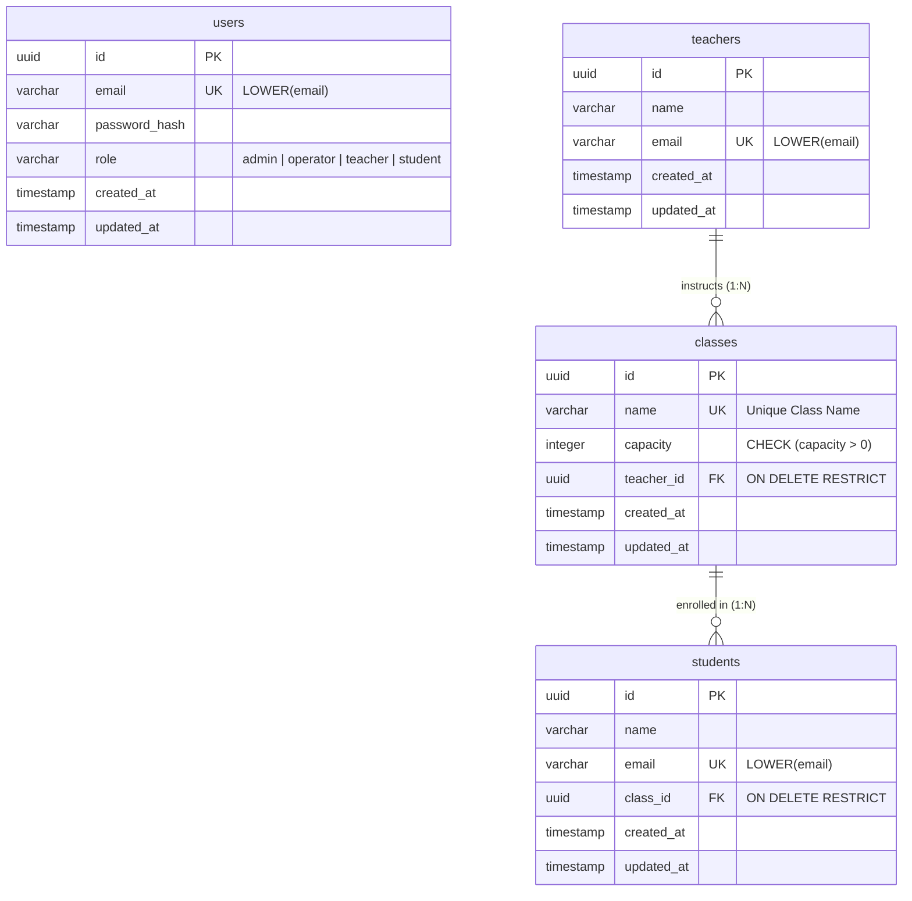
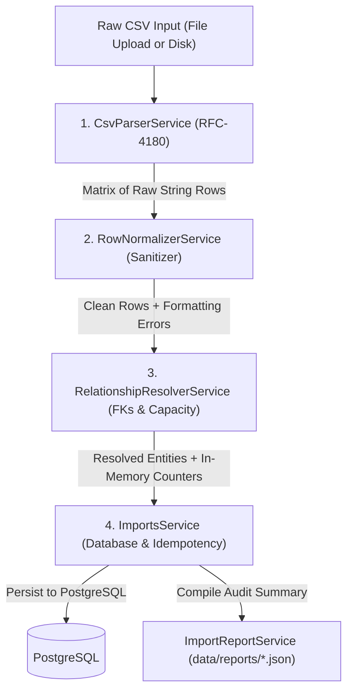
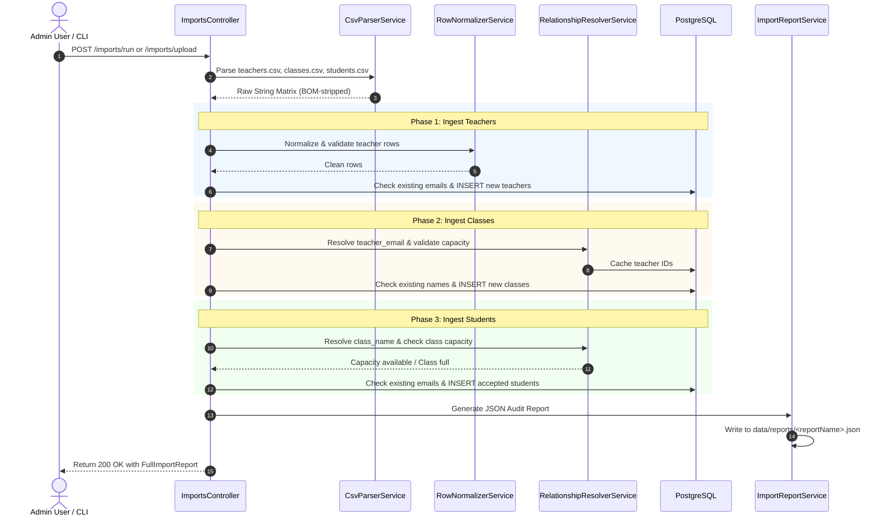

# 🏫 School Management REST API

[](https://nestjs.com/)
[](https://www.typescriptlang.org/)
[](https://www.postgresql.org/)
[](https://typeorm.io/)
[](https://swagger.io/)
[](https://oxc.rs/)
[](https://vitest.dev/)

> An enterprise-grade, high-concurrency School Management REST API built with **NestJS**, **TypeORM**, and **PostgreSQL**. Featuring multi-tier **Role-Based Access Control (RBAC)**, ACID database transactions with **pessimistic write locking**, an industrial **RFC-4180 CSV import engine**, and full OpenAPI/Swagger documentation.

---

## 📑 Table of Contents

- [Project Architecture](#-project-architecture)
  - [Modular & Layered Architecture](#modular--layered-architecture)
  - [Object-Oriented Programming (OOP) Principles](#object-oriented-programming-oop-principles)
  - [HTTP Request Lifecycle](#http-request-lifecycle)
  - [Database Schema & Referential Integrity](#database-schema--referential-integrity)
  - [Concurrency Control: Pessimistic Write Locking](#concurrency-control-pessimistic-write-locking)
- [How Importing Works (CSV Engine Deep Dive)](#-how-importing-works-csv-engine-deep-dive)
  - [The 4-Stage Ingestion Pipeline](#the-4-stage-ingestion-pipeline)
  - [Two Operational Modes: UI Upload vs. Batch Run](#two-operational-modes-ui-upload-vs-batch-run)
  - [Deterministic Execution Order](#deterministic-execution-order)
  - [CSV File Specifications & Headers](#csv-file-specifications--headers)
  - [Data Sanitization & Normalization](#data-sanitization--normalization)
  - [Idempotency & Deduplication Guarantees](#idempotency--deduplication-guarantees)
  - [Audit Reporting (`data/reports/*.json`)](#audit-reporting-datareportsjson)
  - [Import Sequence Diagram](#import-sequence-diagram)
- [Pre-Seeded Demo Accounts & RBAC Matrix](#-pre-seeded-demo-accounts--rbac-matrix)
- [Quick Start Guide](#-quick-start-guide)
  - [1. Database Setup (Docker Compose)](#1-database-setup-docker-compose)
  - [2. Environment Configuration](#2-environment-configuration)
  - [3. Install Dependencies](#3-install-dependencies)
  - [4. Migrations & Database Seeding](#4-migrations--database-seeding)
  - [5. Run Development Server](#5-run-development-server)
- [REST API Reference & Swagger](#-rest-api-reference--swagger)
- [Testing & Quality Assurance](#-testing--quality-assurance)
- [Frontend Client Connection](#-frontend-client-connection)

---

## 🏗 Project Architecture

### Modular & Layered Architecture

NestJS enforces an opinionated, modular structure using Inversion of Control (IoC). Every domain is encapsulated in its own module:

```text
src/
├── app.module.ts              # Root DI container importing all feature modules
├── main.ts                    # Bootstrap entrypoint (CORS, Helmet, ValidationPipe, Swagger)
├── auth/                      # Authentication (JWT, PassportStrategy, Login, /auth/me)
├── users/                     # User credentials, roles, and password hashing
├── teachers/                  # Teachers domain (Controller, Service, Entity, DTOs)
├── classes/                   # Classes domain (Capacity checks, Teacher FK, DTOs)
├── students/                  # Students domain (Pessimistic locking, Class assignment)
├── imports/                   # CSV Engine (Parser, Normalizer, Resolver, Reports)
├── database/                  # TypeORM data-source, migrations, and seeders
├── common/                    # Shared decorators (@Roles, @CurrentUser), filters, base entities
├── config/                    # Type-safe environment configuration & validation
└── health/                    # Liveness probe endpoint (/health)
```

Each domain module is organized into distinct functional layers:
1. **Controllers (`*.controller.ts`)**: Thin routing layer responsible for receiving HTTP requests, binding DTOs, enforcing role guards, and delegating to services.
2. **Services (`*.service.ts`)**: Core business logic layer containing validation rules, domain orchestration, and transactional workflows.
3. **Data Mapper Entities (`*.entity.ts`)**: TypeORM models mapping tables, columns, relations, and database-level constraints.
4. **Data Transfer Objects (DTOs)**: Strongly typed request bodies validated at runtime by `class-validator` and transformed by `class-transformer`.
5. **Guards & Decorators**: Security interceptors verifying JWT tokens (`JwtAuthGuard`) and checking role permissions (`RolesGuard`).
6. **Exception Filters (`GlobalExceptionFilter`)**: Catch-all filter translating NestJS and PostgreSQL database errors (e.g., `23505` unique violation, `23503` foreign key violation) into standardized JSON responses.

---

### Object-Oriented Programming (OOP) Principles

The application is architected around foundational OOP principles:

- **Encapsulation**:
  - Injected dependencies (`repository`, `configService`) are declared as `private readonly` in constructor parameters, hiding internal state from outside consumers.
  - Sensitive columns (such as `passwordHash` in `UserEntity`) are marked with `{ select: false }` so password hashes are never leaked in queries unless explicitly requested.
- **Inheritance**:
  - `JwtAuthGuard extends AuthGuard('jwt')`: Customizes authentication behavior while inheriting core Passport logic.
  - `JwtStrategy extends PassportStrategy(Strategy)`: Subclasses Passport's JWT extraction and verification pipeline.
  - `UpdateTeacherDto extends PartialType(CreateTeacherDto)`: Reuses validation rules without code duplication.
- **Polymorphism & Interfaces**:
  - Guards implement NestJS's `CanActivate` contract.
  - Exception filters implement `ExceptionFilter`.
  - The CSV engine processes rows polymorphically through the normalized row interfaces (`NormalizedTeacherRow`, `NormalizedClassRow`, `NormalizedStudentRow`).
- **Dependency Injection & Inversion of Control (IoC)**:
  - All services are decorated with `@Injectable()`.
  - Nest's IoC container manages singletons, decoupling consumers from concrete implementations and facilitating unit testing.

---

### HTTP Request Lifecycle

Every inbound request flows through a strict, predictable pipeline:



---

### Database Schema & Referential Integrity

The relational data model enforces strict data integrity via PostgreSQL constraints:



- **UUID Primary Keys**: Generated via `uuidv4()` to eliminate enumeration vulnerabilities.
- **Case-Insensitive Uniqueness**: Emails are indexed and verified using `LOWER(email)`.
- **Referential Integrity (`ON DELETE RESTRICT`)**:
  - A Teacher cannot be deleted while assigned to any Class.
  - A Class cannot be deleted while any Student is enrolled in it.

---

### Concurrency Control: Pessimistic Write Locking

Under high concurrency (e.g., multiple operators enrolling students simultaneously into a class with 1 seat remaining), standard read-then-write checks suffer from **race conditions** leading to over-enrollment.

To prevent this, `StudentsService` wraps student enrollment and class re-assignment inside an explicit database transaction with **Pessimistic Write Locking**:

```typescript
await this.dataSource.transaction(async (manager) => {
  // Acquires an exclusive row-level lock (SELECT ... FOR UPDATE)
  const schoolClass = await manager
    .getRepository(ClassEntity)
    .createQueryBuilder('c')
    .setLock('pessimistic_write')
    .leftJoinAndSelect('c.students', 's')
    .where('c.id = :id', { id: dto.classId })
    .getOne();

  if (!schoolClass) {
    throw new NotFoundException(`Class with ID "${dto.classId}" not found`);
  }

  // Atomically check capacity under lock
  if (schoolClass.students.length >= schoolClass.capacity) {
    throw new ConflictException(
      `Class "${schoolClass.name}" is at full capacity (${schoolClass.capacity}/${schoolClass.capacity})`
    );
  }

  // Safe to insert: concurrent requests attempting to lock this class row will wait
  const student = manager.getRepository(StudentEntity).create({
    name: dto.name.trim(),
    email: dto.email.toLowerCase().trim(),
    schoolClass,
  });

  return await manager.getRepository(StudentEntity).save(student);
});
```

Similarly, when modifying a class's capacity via `PATCH /classes/:id`, the service verifies that the new capacity is not less than the current enrolled count.

---

## 📊 How Importing Works (CSV Engine Deep Dive)

The import engine is designed to ingest raw, un-sanitized CSV files while guaranteeing **data cleanliness**, **referential integrity**, and **strict idempotency**.

### The 4-Stage Ingestion Pipeline



#### 1. `CsvParserService` (RFC-4180 Parsing & BOM Stripping)
- Strips UTF-8 Byte Order Marks (`0xEF, 0xBB, 0xBF`) commonly injected by Microsoft Excel.
- Implements custom RFC-4180 state-machine parsing without fragile external dependencies:
  - Supports commas inside quotes: `"Salma, Adel",salma@example.com` &rarr; name: `Salma, Adel`, email: `salma@example.com`.
  - Handles multiline values and escaped quotes (`""`).
  - Normalizes CRLF (`\r\n`) and LF (`\n`) line breaks.

#### 2. `RowNormalizerService` (Sanitization & Constraint Validation)
- Strips leading, trailing, and duplicate inner whitespace: ` Ahmed   Hassan ` &rarr; `Ahmed Hassan`.
- Normalizes all email addresses to lowercase: `AHMED.HASSAN@EXAMPLE.COM` &rarr; `ahmed.hassan@example.com`.
- Validates regex email formats and rejects malformed values (`hany.example.com`).
- Enforces numeric constraints: Class capacity must be a positive integer (`capacity > 0`); rejects strings, floats, and zero.

#### 3. `RelationshipResolverService` (Foreign Keys & Dynamic Capacity Tracking)
- Caches existing database records (teachers and classes) to avoid $O(N)$ query loops.
- Resolves foreign keys by matching normalized teacher emails and class names.
- Tracks real-time class occupancy during the import run:
  - When students are assigned to `Grade 1 A` (capacity: 3), an in-memory counter increments for each accepted student.
  - If a 4th student is encountered in the CSV, the row is rejected with: `Class "Grade 1 A" is full (capacity: 3)`.

#### 4. `ImportsService` & `ImportReportService` (Persistence & Audit)
- Orchestrates the deterministic multi-entity ingestion order.
- Handles deduplication and idempotency.
- Persists accepted records into PostgreSQL.
- Formats a comprehensive audit report and writes it to `data/reports/<reportName>.json`.

---

### Two Operational Modes: UI Upload vs. Batch Run

1. **Interactive Multipart Upload (`POST /imports/upload`)**:
   - Accepts multiple CSV files (`teachers.csv`, `classes.csv`, `students.csv`) via `multipart/form-data`.
   - Used by the web dashboard for instant single-click imports.
   - Responds with `200 OK` and returns the `FullImportReport` payload for immediate display in UI tables.

2. **Headless Batch Import (`POST /imports/run`)**:
   - Reads files from a directory on disk (default: `data/source/`).
   - Accepts a JSON payload specifying `sourceDir` and `reportName`:
     ```json
     {
       "sourceDir": "data/source",
       "reportName": "initial-import.json"
     }
     ```
   - Ideal for CI/CD pipelines, automated scripts, and system migrations.

---

### Deterministic Execution Order

Relational dependencies require a strict import order:

$$\text{Teachers} \longrightarrow \text{Classes} \longrightarrow \text{Students}$$

1. **Teachers First**: Creates instructor profiles so classes have valid teacher foreign keys.
2. **Classes Second**: Creates classrooms with capacity limits and links them to the resolved teachers.
3. **Students Third**: Enrolls students into classes with resolved foreign keys and enforced capacity limits.

---

### CSV File Specifications & Headers

Files placed in `data/source/` or uploaded via the UI must include the following headers:

#### `teachers.csv`
```csv
name,email
Ahmed Hassan,ahmed.hassan@example.com
Mona Ali,mona.ali@example.com
"Salma, Adel",salma.adel@example.com
ليلى محمود,layla.mahmoud@example.com
```

#### `classes.csv`
```csv
name,capacity,teacher_name,teacher_email
Grade 1 A,3,Ahmed Hassan,ahmed.hassan@example.com
Grade 1 B,4,Mona Ali,mona.ali@example.com
Science Club,2,"Salma, Adel",salma.adel@example.com
```

#### `students.csv`
```csv
name,email,class_name
Youssef Ahmed,youssef.ahmed@example.com,Grade 1 A
Farida Mahmoud,farida.mahmoud@example.com,Grade 1 A
"Adam, Karim",adam.karim@example.com,Grade 1 A
ملك أحمد,malak.arabic@example.com,Arabic Club
```

---

### Idempotency & Deduplication Guarantees

The import engine guarantees **idempotency**: running the import multiple times produces identical state without duplicate records or errors.

| Row Condition | Status | Action Taken | Audit Log Message |
| :--- | :---: | :--- | :--- |
| **New valid entity** | `created` | Inserted into PostgreSQL | `Record created with ID <uuid>` |
| **Email/Name already in DB** | `skipped` | Ignored (preserved in DB) | `Entity with email/name already exists` |
| **Duplicate row in same CSV** | `rejected` | Blocked | `Duplicate entry within this CSV batch` |
| **Class capacity exceeded** | `rejected` | Blocked | `Class "<name>" is full (capacity: <cap>)` |
| **Teacher/Class not found** | `rejected` | Blocked | `Assigned teacher/class does not exist` |
| **Malformed syntax** | `rejected` | Blocked | `Invalid email format / capacity must be > 0` |

---

### Audit Reporting (`data/reports/*.json`)

Every import execution automatically writes an audit artifact to `data/reports/`. The report provides complete visibility into what was imported, skipped, or rejected:

```json
{
  "timestamp": "2026-11-19T21:45:00.123Z",
  "sourceDir": "data/source",
  "reportName": "initial-import.json",
  "totals": {
    "totalRows": 57,
    "created": 32,
    "skipped": 12,
    "rejected": 13
  },
  "entities": {
    "teachers": {
      "total": 12,
      "created": 7,
      "skipped": 2,
      "rejected": 3,
      "rows": [
        {
          "rowNumber": 2,
          "status": "created",
          "recordId": "4a7b5d12-e421-4f12-8921-b3bcf91c4501",
          "data": { "name": "Ahmed Hassan", "email": "ahmed.hassan@example.com" }
        },
        {
          "rowNumber": 12,
          "status": "rejected",
          "reason": "Invalid email address format",
          "data": { "name": "Hany Mostafa", "email": "hany.example.com" }
        }
      ]
    }
  }
}
```

---

### Import Sequence Diagram



---

## 👥 Pre-Seeded Demo Accounts & RBAC Matrix

The database seeder (`npm run seed`) populates 4 test accounts representing each permission tier:

| Role | Email | Password | Read (`GET`) | Create / Edit (`POST`/`PATCH`) | Delete (`DELETE`) | CSV Import (`/imports`) |
| :--- | :--- | :--- | :---: | :---: | :---: | :---: |
| **Admin** | `admin@school.local` | `Admin123!` | ✅ | ✅ | ✅ | ✅ |
| **Operator** | `operator@school.local` | `Operator123!` | ✅ | ✅ | ❌ | ❌ |
| **Teacher** | `teacher@school.local` | `Teacher123!` | ✅ | ❌ | ❌ | ❌ |
| **Student** | `student@school.local` | `Student123!` | ✅ | ❌ | ❌ | ❌ |

---

## 🚀 Quick Start Guide

### 1. Database Setup (Docker Compose)
Start the PostgreSQL 16 container:
```bash
docker compose up -d
```

### 2. Environment Configuration
Copy the sample environment file:
```bash
cp env.example .env
```
Default configuration:
```ini
NODE_ENV=development
PORT=3000
DB_HOST=localhost
DB_PORT=5432
DB_USERNAME=postgres
DB_PASSWORD=postgres
DB_NAME=school_management
JWT_SECRET=dev_jwt_secret_change_in_production_min_32_chars
JWT_EXPIRES_IN=1d
```

### 3. Install Dependencies
```bash
npm install
```

### 4. Migrations & Database Seeding
```bash
# Apply database schema
npm run migration:run

# Seed the 4 RBAC demo users
npm run seed
```

### 5. Run Development Server
```bash
npm run start:dev
```

The API will be live at:
- **Base URL**: `http://localhost:3000`
- **Swagger Documentation**: `http://localhost:3000/docs`
- **OpenAPI JSON Spec**: `http://localhost:3000/openapi.json`
- **Health Check**: `http://localhost:3000/health`

---

## 📡 REST API Reference & Swagger

Interactive Swagger UI documentation is available at **`http://localhost:3000/docs`**.

### Endpoints Overview

| Module | Method | Endpoint | Allowed Roles | Description |
| :--- | :---: | :--- | :---: | :--- |
| **Auth** | `POST` | `/auth/login` | *Public* | Authenticate with credentials; returns JWT token |
| | `GET` | `/auth/me` | Authenticated | Retrieve profile and role of authenticated user |
| **Teachers** | `GET` | `/teachers` | All Roles | List teachers with assigned class counts |
| | `POST` | `/teachers` | `admin`, `operator` | Create a new teacher |
| | `GET` | `/teachers/:id` | All Roles | Get teacher details by ID |
| | `PATCH` | `/teachers/:id` | `admin`, `operator` | Update teacher name or email |
| | `DELETE` | `/teachers/:id` | `admin` | Delete teacher (`ON DELETE RESTRICT`) |
| **Classes** | `GET` | `/classes` | All Roles | List classes with teacher and enrollment count |
| | `POST` | `/classes` | `admin`, `operator` | Create class with capacity and assigned teacher |
| | `GET` | `/classes/:id` | All Roles | Get class details by ID |
| | `PATCH` | `/classes/:id` | `admin`, `operator` | Update class name, capacity, or assigned teacher |
| | `DELETE` | `/classes/:id` | `admin` | Delete class (`ON DELETE RESTRICT`) |
| **Students** | `GET` | `/students` | All Roles | List students with assigned class |
| | `POST` | `/students` | `admin`, `operator` | Enroll student (Pessimistic write locked) |
| | `GET` | `/students/:id` | All Roles | Get student details by ID |
| | `PATCH` | `/students/:id` | `admin`, `operator` | Reassign student class or update profile |
| | `DELETE` | `/students/:id` | `admin` | Un-enroll and remove student |
| **Imports** | `POST` | `/imports/run` | `admin` | Execute directory batch CSV import |
| | `POST` | `/imports/upload` | `admin` | Upload and process CSV files via multipart form |
| **Health** | `GET` | `/health` | *Public* | Liveness and readiness probe |

### Standardized Error Format
All errors return a predictable structure:
```json
{
  "statusCode": 409,
  "error": "Conflict",
  "message": "Class \"Grade 1 A\" is at full capacity (3/3)",
  "path": "/students",
  "timestamp": "2026-11-19T21:45:10.000Z"
}
```

---

## 🧪 Testing & Quality Assurance

```bash
# Run unit tests (Vitest)
npm run test

# Run E2E integration tests
npm run test:e2e

# Run Oxlint high-speed linter
npm run lint

# Production build verification
npm run build
```

---

## 🖥 Frontend Client Connection

The companion React 18 + Vite frontend is included in `./school-management-frontend`.

To start the frontend:
```bash
cd school-management-frontend
cp .env.example .env
npm install
npm run dev
```

The frontend dashboard will run at **`http://localhost:5173`** and communicate directly with this API at `http://localhost:3000`.
